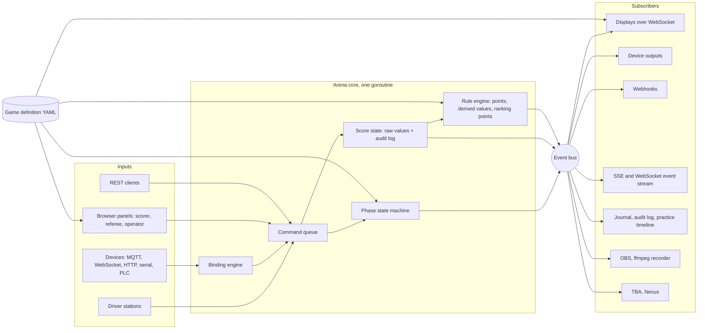

# Galaxia FMS: implementation plan

Status: **approved on 2026-11-12.** The decisions are recorded in section 1. Progress is tracked milestone by
milestone in [docs/milestones/](milestones/).

Contents

1. [Decisions](#1-decisions)
2. [What I found](#2-what-i-found)
3. [Architecture](#3-architecture)
4. [Keep, replace, delete](#4-keep-replace-delete)
5. [Data model](#5-data-model)
6. [Draft game definition schema (v1)](#6-draft-game-definition-schema-v1)
7. [Draft device protocol (v1)](#7-draft-device-protocol-v1)
8. [Match flow and the countdown](#8-match-flow-and-the-countdown)
9. [Practice and scrimmage modes](#9-practice-and-scrimmage-modes)
10. [API, events, webhooks, integrations](#10-api-events-webhooks-integrations)
11. [Displays and media](#11-displays-and-media)
12. [Diagnostics and networking modes](#12-diagnostics-and-networking-modes)
13. [Operations and security](#13-operations-and-security)
14. [Library choices](#14-library-choices)
15. [Testing and CI](#15-testing-and-ci)
16. [Milestones](#16-milestones)
17. [Risks and limits](#17-risks-and-limits)

---

## 1. Decisions

Settled with David on 2026-11-12.

| # | Question | Decision |
|---|----------|----------|
| D1 | Licence and publishing | The work is published on David's GitHub fork of Cheesy Arena. `LICENSE` and every Team 254 notice are kept unchanged. The licence's limit on redistributing modifications still applies ([2.4](#24-licence)); asking Team 254 for their blessing remains worth doing. |
| D2 | Fork sync | `main` was reset to upstream `main` and Galaxia is built there. The previous `main` is preserved as the branch `legacy/community-2026`. One behaviour is carried over from it: David's radio change, which configures the field radio without configuring a managed switch ([section 12](#12-diagnostics-and-networking-modes)). |
| D3 | Game definition schema | Approved as drafted in [section 6](#6-draft-game-definition-schema-v1). |
| D4 | Device protocol | Approved as drafted in [section 7](#7-draft-device-protocol-v1). |
| D5 | Expression language | `expr-lang/expr` ([6.9](#69-expression-language)). |
| D6 | Alliance shapes | Both. The official format (two alliances of three, with alliance selection and bracket playoffs) and the general one (1 to 4 alliances of 1 to 4 robots, without brackets). See [5.2](#52-alliances-and-stations). |
| D7 | Names | Repository `galaxia-fms`, Go module `github.com/DavidMasin/galaxia-fms`. |
| D8 | Fork-only features | Fortinet switch support and the Jetson Modbus script are dropped. A Jetson or Raspberry Pi with GPIO becomes an ordinary device through the Python client. |
| D9 | Smart App Control on the development laptop | Left as it is; operating-system security settings are David's to change. Formatting uses a `gofmt` built from the Go source tree (`go run cmd/gofmt`), which runs. Blocked test binaries are re-run, and GitHub Actions is the authority on test results. |
| D10 | LED configuration (added by David, "very important") | A dedicated Lighting page: [7.8](#78-lighting-page). |

Still useful to know, but not blocking: which microcontroller boards are on hand (ESP32 variant, Pico W or
Pico 2 W), which switch and access point the tent uses, and whether the field PC will run Windows or Linux.

---

## 2. What I found

### 2.1 Your fork

- `origin` is `DavidMasin/cheesy-arena`, a fork of `Team254/cheesy-arena`.
- Fork `main` and upstream `main` split on 2026-02-07 (`bc660ae`). Since then:
  - Fork: 126 commits. 125 are by other authors, mostly from the `Li-Kai-Huang/cheesy-arena` `2026frcgame`
    branch (a community implementation of the 2026 game, Fortinet switch support, a Jetson Modbus PLC
    script, extra images and videos). One is yours (`f270f56`, "Changes"): per-station game data, a
    `-skipStationMatch` flag, a `-serverIP` flag, and the team Ethernet switch configuration commented out.
  - Upstream: 100 commits. The official 2026 game, DMX hub lighting, a four-alliance double-elimination
    bracket, the 2027 driver station protocol, Nexus AutoQueue, an FMS-style field monitor, better logging,
    and Go 1.26.
- Upstream now covers all four of your changes in its own way: game data is sent to driver stations; a
  `-dev` flag binds the listeners to every address; and with "network security" switched off in settings it
  skips both the station-mismatch check and the switch configuration. Nothing of yours needs porting.
  Galaxia turns that combination into one "flat network" setting.
- After approval, `main` was reset to upstream `main` (`248d9de`) and the old `main` was pushed as
  `legacy/community-2026`. An `upstream` remote points at Team254 for future merges.

### 2.2 The codebase (upstream `248d9de`)

About 34,500 lines of Go (15,000 of them tests), 5,100 lines of templates, 5,000 lines of JavaScript.

| Package | Role | Game-specific? |
|---------|------|----------------|
| `field` | Arena loop (10 ms), match state machine, driver station TCP/UDP, team signs, displays registry, notifiers, per-team match logs | Mixed. The state machine is a fixed Auto, Pause, Teleop sequence; hub scoring, hub lights and "who won auto" are woven into `Update()` and `handlePlcInputOutput()`. |
| `game` | Score struct, hub and tower logic, fouls and the rule list, ranking fields and sort order, match timing, sound cue times | Entirely. This is the package Galaxia replaces. |
| `led` | sACN/DMX controller for the 2026 hub lights | Entirely, except the colour type and packet writer. |
| `plc` | Modbus PLC client. Inputs, registers and coils are fixed Go enums. | Mixed. E-stops, A-stops, stack lights and "FTA ready" are generic; hub sensors, motors and lights are not. |
| `model` | bbolt tables: teams, matches, results, rankings, alliances, awards, settings, sessions | Mixed. `MatchResult` embeds `game.Score`; `EventSettings` has 2026 timing and thresholds; `Match` has fixed `Red1..Blue3` fields. |
| `network` | Access point (Vivid-Hosting radio API), Cisco switch, SCC switches | Generic. Fixed at six team networks. |
| `partner` | The Blue Alliance, Nexus, Blackmagic, Bitfocus Companion | TBA score breakdown is game-specific; the rest is generic. |
| `playoff` | Single and double elimination brackets | Generic. Two alliances per match. |
| `tournament` | Schedule builder (reads 1,330 pre-generated 6-team schedules), rankings, cards, awards, judging | Generic apart from the ranking types it borrows from `game`. |
| `web` | HTTP handlers, 15 display types, scoring and referee panels, setup pages, PDF and CSV reports | Mixed. Scoring panel, referee panel, match review, audience overlay, announcer, rankings and settings each have 2026 blocks. |
| `websocket` | A small publish/subscribe notifier per message type | Generic. |

Other facts that shape the plan:

- **Concurrency.** The arena loop and the HTTP handlers mutate `Arena` from different goroutines with no
  locking. That is survivable with a handful of human operators. It is not with devices publishing score
  inputs many times a second.
- **Assets are read from disk.** `templates/` and `static/` must sit next to the binary. "Single binary"
  needs `go:embed`.
- **The database is opened with `NoSync: true`.** Fast, but a power cut can lose recent writes.
- **Auth is one shared admin password.** No roles. Displays, API and logs are open.
- **Driver station protocol.** The control packet carries match type, a 16-bit match number and a repeat
  number (hard-coded to 1). The alliance station byte can only say Red 1-3 or Blue 1-3.
- **Nexus.** Upstream already pulls lineups from Nexus and pushes `match-start`, `break-start`, `break-end`
  and `post-scores` to a Nexus "auto-queue" endpoint.

### 2.3 Test baseline and this laptop

Go 1.27.4 is installed (through `winget`, into `C:\Program Files\Go`). Upstream needs Go 1.26.7 or newer.

On unmodified upstream, on this laptop:

- `go build` succeeds and the binary runs.
- `go test ./...`: `field`, `model`, `network`, `partner`, `plc`, `tournament`, `websocket` pass.
- `web` fails two tests on every run: `TestAllianceStationDisplayWebsocket` and
  `TestAnnouncerDisplayWebsocket`. Both count WebSocket messages after one arena tick and receive one extra.
  Upstream's own CI (Ubuntu) is green, so this looks specific to Windows; my best guess is the coarser clock
  making the 2026 hub-timing code emit an extra score update. I have not confirmed the cause. That code is
  deleted in milestone 3.
- `game`, `led` and `playoff` did not run in the full pass because **Smart App Control blocked their test
  binaries** ("An Application Control policy has blocked this file"). It also blocks `gofmt.exe` every time
  and blocked the Go linker once before allowing it. The Go binaries are not Authenticode-signed, and every
  test binary is a brand-new unsigned executable, so the blocks are unpredictable.

What that means: on this laptop I cannot format code with `gofmt`, and any local test run can fail for
reasons unrelated to the code. I have not changed any security setting. The options, all yours to choose:

1. Turn Smart App Control off in Windows Security. Check first whether your Windows build lets you turn it
   back on; on older builds it could not be re-enabled without reinstalling Windows.
2. Install WSL and do Go work inside Linux, where Smart App Control does not apply. That is a Windows feature
   install that needs admin rights.
3. Leave it on. I treat GitHub Actions as the source of truth for test results and formatting, and retry
   local runs. This is slower and depends on D1, because CI needs the code on GitHub.

Also not installed, and needed in later milestones: `ffmpeg` (milestone 9), PlatformIO (milestone 6), OBS
(milestone 9). I will ask before installing each.

### 2.4 Licence

`LICENSE` in full, minus the warranty disclaimer:

> 1. The software may be used without restriction for testing, scrimmages, off-season events, and for
>    evaluation purposes.
> 2. The software may be modified for such use, but the modifications may not be redistributed without
>    permission from Team 254.
> 3. Redistribution for the purpose of contributing to the original project (e.g. forking on GitHub and
>    submitting pull requests) is permitted.

Consequences for Galaxia:

- Running a modified Cheesy Arena on your own practice field is clearly allowed.
- Publishing the modified source is allowed only with Team 254's permission, or as a contribution back.
- I will keep `LICENSE` and every Team 254 copyright header exactly as they are, and add a `NOTICE` file
  describing what Galaxia changed.
- Code that is wholly new and does not derive from Cheesy Arena (firmware SDKs, the Python client, example
  sketches, game definition files) can carry its own permissive licence, for example MIT, in its own
  directory. The FMS binary as a whole stays under Team 254's terms.

The match sounds that ship with Cheesy Arena (`start.wav`, `end.wav` and so on) stay as they are, under the
same terms. All countdown audio will be new and original to this project.

### 2.5 What Cheesy Arena Lite shows

Lite is current (it was resynchronised with the full version through September 2026), so it is a fair
picture of how Team 254 themselves strip the game out. They did it by reduction, not abstraction:

- A score becomes four integers per alliance (auto, teleop, post-match, foul points against). One scoring
  panel types them in. Fouls lose their team and rule. Bonus ranking points and playoff tiebreakers are
  gone.
- Publishing to The Blue Alliance is switched off entirely rather than made generic.
- Game data to driver stations, the endgame Companion event and the LED package are removed, because only
  game code fed them.
- `PUT` and `PATCH /api/scores` let an external program set or add to those integers. The handler has no
  authentication.

What I take from it:

- The score summary's field names are the widest coupling in the codebase. They reach notifiers, team
  signs, reports, the API, six templates, four scripts and the TBA breakdown. Galaxia needs one generic
  shape (breakdown rows plus named values) that all of those read, or each will need touching per game.
- Fouls are the deepest coupling. They need a proper generic model, not an integer.
- Brackets, the field monitor, networking and the display registry needed no changes in Lite. They should
  need little in Galaxia.
- Upstream names game-only tests `*GameSpecific`, which makes them easy to find and replace.

---

## 3. Architecture

### 3.1 Shape



### 3.2 Principles, and how each one is enforced

| Principle | Mechanism |
|-----------|-----------|
| Game logic is data | The `game` package is deleted. A CI test greps Go, templates and JavaScript for a deny-list of game words (element names from the example games) and fails if any appear outside `games/`. |
| Everything is an event | State changes happen only inside the arena core, and every one publishes to the bus. Displays, outputs, webhooks, logs and recorders have no other way to learn about state. |
| Raw state in, score out | The database stores raw element values and the list of changes. Points, totals, ranking points and rankings are always computed. A stored total is only ever a cache with the definition hash it was computed from. |
| Humans override sensors | Every element is editable from the scoring panel regardless of who else may write it. Every change records its source (device id, user, rule, API token). |
| Offline first | No feature needs the internet at match time. TBA, Nexus, webhooks and video upload go through a persistent outbox with retry. Ratings for win probability are cached. All browser assets are served locally. |
| Fail safe | A device channel marked `safety` must send a heartbeat. Silence is treated as the stop being pressed. After a crash the FMS never re-enables robots on its own. |

### 3.3 The arena core

Today the HTTP handlers reach into `Arena` directly. Galaxia puts a **command queue** in front of it:

- Every mutation (start match, score change, foul, device input, settings change) is a command posted to a
  channel and applied by the arena goroutine between ticks.
- Reads for displays and the API come from an immutable snapshot the core republishes after each change.
- The loop stays at 10 ms but sleeps until the next scheduled deadline when one is closer, so phase
  boundaries and the "GO!" instant are hit within about a millisecond rather than within a tick.
- Database writes are handed to a writer goroutine so a slow disk never stalls the loop.

This removes the existing data races and gives devices, panels and the API one ordered path into the match.

### 3.4 Packages

New packages are marked with a plus sign.

| Package | Contents |
|---------|----------|
| `gamedef` + | YAML types, loader, embedded JSON Schema, semantic validation, hot reload, game registry |
| `rules` + | Expression compilation and evaluation, the expression environment, static checks |
| `scoring` + | Raw score state, change events, undo, score computation, ranking computation |
| `bus` + | Event envelope, publish/subscribe with bounded queues, replay ring, on-disk journal |
| `device` + | Registry, manifests, channels, transports (`mqtt`, `ws`, `http`, `serial`, `plc`, `virtual`), bindings, safety watchdog |
| `practice` + | Solo runs, auto loop, drivers, cycle tracking, queue, scrimmage wizard, dry run |
| `api` + | REST v1, OpenAPI document, SSE and WebSocket streams, webhooks, exports |
| `media` + | Countdown scheduling, sound catalogue, theme, OBS client, ffmpeg recorder |
| `diag` + | Connection reports, field health checks |
| `ops` + | Service install, crash recovery, backups, UPS monitor, users and roles |
| `sim` + | Simulated driver stations, scripted scorer, used by dry run and integration tests |
| `field` | Arena core, phase state machine, driver station protocol, team signs, displays registry |
| `model` | bbolt tables (changed, see [section 5](#5-data-model)) |
| `network`, `playoff`, `tournament`, `websocket` | Kept, with the changes in [section 4](#4-keep-replace-delete) |
| `partner` | TBA (generic breakdown and validator), Nexus, Blackmagic, Companion, Statbotics, YouTube |
| `web` | Page handlers and templates. Scoring, referee and display templates become generic renderers. |
| `sdk/` + | `arduino/` (PlatformIO library), `micropython/`, `python/`, `examples/` with wiring diagrams |
| `games/` + | The three example games |
| `docs/` + | Quick start, game reference, sensor tutorial, tent guide, API reference |

---

## 4. Keep, replace, delete

### Keep as is (or nearly)

- Driver station TCP and UDP protocol, including the 2027 protocol and game data transport.
- Access point, switch and SCC configuration (`network`).
- Schedule generation for 2x3 games, schedule blocks, scheduled breaks.
- Playoff brackets, alliance selection, awards, judging schedule, sponsor slides, lower thirds.
- TBA publishing of teams, matches, rankings, alliances and awards. Nexus lineups and AutoQueue.
- Blackmagic and Companion clients, re-pointed to listen on the event bus.
- The display registry and the per-display WebSocket pattern. The `websocket.Notifier` stays as the
  transport to browsers and is fed from the bus.
- Per-team match logs (they become the input to connection reports).
- Timeouts, test matches, field reset and volunteer signals, team signs.
- PDF and CSV reports, apart from game-specific columns.
- The no-build-step front end: plain JavaScript, Bootstrap, vendored libraries.

### Replace

| Today | Becomes |
|-------|---------|
| `game.Score`, `Hub`, `TowerStatus`, `Summarize` | `scoring.State` (raw values keyed by element) and `scoring.Compute` driven by the definition |
| `game.MatchTiming`, fixed `MatchState` enum | Phase list from the definition; states are Idle, Countdown, Phase(n), Post, Timeout |
| `game.MatchSounds` | Cues declared per phase |
| `game.Rule`, `game.Foul` | Foul types, rule catalogue and cards from the definition |
| `game.RankingFields`, hand-written sort | Ranking points, accumulated stats and ordered tiebreakers from the definition |
| `game.DetermineMatchStatus` tiebreakers | Playoff tiebreaker list from the definition |
| `Match.Red1..Blue3`, `"R1".."B3"` station keys | Alliance and slot lists; station ids built from the alliance short code and position |
| Fixed Auto/Pause/Teleop branches in `Arena.Update` | A loop over phases |
| `handleAutoWinner`, hub lights, hub motors | Triggers, live values and output bindings |
| `plc.Plc` interface with named getters | A `device` transport exposing every Modbus input, register and coil as a channel. Field E-stop, station stops, stack lights and "ready" become default bindings. |
| Scoring panel, referee panel, match review editor | Generic renderers that build controls from the definition |
| Audience overlay score area, final score, announcer, rankings columns | Generic renderers reading layout hints, with optional per-game template and CSS overrides |
| `TbaScoreBreakdown` struct | Breakdown map generated from the definition, plus a validator |
| Admin-only auth | Users, roles, sessions, API tokens |
| Disk-loaded `templates/` and `static/` | `go:embed`, with an on-disk override directory |
| Game settings fields in `EventSettings` | Selected game id and parameter overrides |

### Delete

- `game/` (all of it, once milestone 3 has moved every caller).
- `led/` hub fixtures, zones and modes, and `field/arena_leds.go`. The sACN packet writer is kept and
  re-exposed as an output transport so a DMX universe can be driven by output bindings.
- 2026 PLC enums, `GetHubCounts`, `SetHubMotors`, `SetHubLights`.
- 2026 blocks in templates, JavaScript and CSS, `shift_change.wav`, `game-logo.png`.
- 2026 settings fields and the "Game-Specific" settings fieldset.

Nothing from your old `main` is deleted; it stays on `legacy/community-2026` (see D2).

---

## 5. Data model

### 5.1 Storage

bbolt stays. It is pure Go, already proven here, and the data is small. Changes:

- Open with syncing on (drop `NoSync`), now that writes happen off the arena loop.
- The event journal and practice timelines are append-only JSON Lines files under `data/journal/`, one per
  day. They are easy to tail, export and line up with robot logs.
- Existing Cheesy Arena databases are not migrated. Galaxia starts a fresh `data/event.db`.

### 5.2 Alliances and stations

A game declares 1 to 4 alliances and 1 to 4 robots per alliance.

- A station id is the alliance short code plus position: `R1`, `B3`, `G2`.
- The driver station protocol can only express Red 1-3 and Blue 1-3. Each alliance declares which driver
  station colour it reports as; position 4 reports as position 3. Robot code that reads its alliance colour
  gets red or blue regardless of the game's alliance names.
- The isolated network mode supports six team networks (that is what the access point and switch
  configuration provide), so it requires at most six robots per match. The flat mode has no such limit.
- Schedules: 2x3 games keep Cheesy Arena's pre-generated schedules. Every other shape uses a new generator
  that balances partners, opponents and station positions.
- Bracket playoffs and alliance selection are offered only when the game has exactly two alliances (D6).

### 5.3 Tables

Changed:

| Table | Change |
|-------|--------|
| `Match` | `Red1..Blue3` replaced by `Alliances []MatchAlliance{AllianceId, PlayoffAlliance, Slots []{TeamId, Surrogate}}`. Adds `GameId`. |
| `MatchResult` | `RedScore`/`BlueScore` replaced by `GameHash`, `State` (raw values), `Cards`, and a `Computed` cache. `PlayNumber` kept. |
| `Ranking` | Fixed fields replaced by `Rp`, `Played`, `Wins`, `Losses`, `Ties`, `Disqualifications`, `Stats map[string]float64`, `Sort []float64`, `Random`. |
| `EventSettings` | Game fields removed. Adds `GameId`, `GameParams`, `NetworkMode`, `FieldProfileId`, countdown and audio settings, backup interval, UPS settings. |
| `UserSession` | Adds role and expiry. |

New:

| Table | Purpose |
|-------|---------|
| `GameSnapshot` | The exact YAML a match was played with, keyed by hash, so old results recompute correctly after the game file changes |
| `ScoreChange` | Audit log: one row per raw change, with source, time, phase and undo link |
| `User`, `ApiToken` | Named accounts with bcrypt password hashes and a role; tokens for API clients |
| `Device` | Id, name, token hash, last manifest, last seen, notes |
| `FieldProfile` | A named physical setup (for example "tent" or "school gym") |
| `BindingSet` | Input and output bindings for one game on one field profile |
| `Webhook`, `WebhookDelivery` | Subscriptions, the outbox, and the delivery log |
| `Driver` | Driver profiles for practice |
| `PracticeRun` | One solo, auto-loop or scrimmage run: stations, driver, routine, outcome, identifiers sent to the driver station, cycle times, clip |
| `QueueEntry` | Self-serve practice queue |
| `TeamRating` | Cached ratings for win probability |
| `MediaClip` | Recording file, source, and the match or run it belongs to |
| `OutboxItem` | Pending TBA, Nexus and upload jobs |

### 5.4 Score state and audit

```text
ScoreChange {
  seq         monotonically increasing per match or run
  time        UTC
  phase       phase id when it happened, or "post" for post-match edits
  match_time  seconds since match start
  target      { alliance, robot? }           robot is a position 1..4
  element     element id, or "foul" / "card"
  op          increment | decrement | set | toggle | timer_start | timer_stop | add | remove
  value       operand
  bucket      phase the change is credited to (differs from phase inside the grace window)
  source      { kind: device|scorer|referee|admin|rule|api, id, name, confidence? }
  reverts     seq of the change this one undoes, if any
}
```

- The raw state is the fold of the change list. Undo appends a reverting change; nothing is ever erased.
- Post-match edits are ordinary changes with `phase: post`. Saving one recomputes the result, the match
  winner, the rankings and the playoff bracket, and re-queues the TBA publish.
- A crash journal mirrors the live match (phase, start time, changes) to disk as it happens.

---

## 6. Draft game definition schema (v1)

One game is a directory: `games/<id>/game.yaml` plus optional `assets/`, `templates/` and `css/`. A JSON
Schema (draft 2020-12) validates the structure. A second pass type-checks every expression, checks every
reference, and checks that scoring expressions do not depend on the clock.

The examples below are illustrative; names of keys are what I am asking you to approve.

### 6.1 Header, alliances, parameters

```yaml
schema: 1
id: ball-count
name: Ball Count
version: "1.0"
description: The smallest possible game. Score balls, most balls wins.

alliances:
  size: 3                       # robots per alliance, 1 to 4
  list:
    - { id: red,  name: Red,  short: R, color: "#d32f2f", ds: red }
    - { id: blue, name: Blue, short: B, color: "#1565c0", ds: blue }

params:                         # tunable per event from the settings page, no YAML edit needed
  bonus_threshold: { name: Bonus threshold, type: int, default: 20, min: 0 }
```

### 6.2 Match phases and the countdown

```yaml
match:
  countdown:
    enabled: true
    voice: drivers_behind_lines   # a sound id; replaceable in settings
    beats: 3                      # "3", "2", "1", then "GO!"
    quick_beats: 1                # used by the auto-only loop
  phases:
    - id: auto
      name: Autonomous
      duration: 15
      robots: auto                # auto | teleop | disabled
      cues:
        - { at: start, sound: match_start }
        - { at: end,   sound: phase_end }
    - id: pause
      name: Pause
      duration: 2
      robots: disabled
    - id: teleop
      name: Teleop
      duration: 135
      robots: teleop
      cues:
        - { at: start,     sound: resume }
        - { remaining: 20, sound: warning, id: endgame }   # id makes it an event outputs can bind to
        - { at: end,       sound: match_end }
  score_grace: 3                  # seconds after a phase ends in which inputs still count for that phase
  ds_game_data: ""                # optional expression giving the string sent to each driver station
```

Any number of phases, in any order, including several disabled pauses.

### 6.3 Scoring elements

```yaml
elements:
  - id: balls
    name: Balls
    type: counter                 # counter | boolean | enum | timer | number
    scope: alliance               # alliance | robot | field
    min: 0
    max: 200
    points: { auto: 4, teleop: 2 }        # a number, a map by phase, or { expr: "..." }
    edit: [device, scorer]                # who may change it live: device, scorer, referee
    phases: [auto, teleop]                # when live changes are accepted; default is every phase
    ui: { group: Scoring, widget: stepper, order: 1 }

  - id: leave
    name: Left the start zone
    type: boolean
    scope: robot
    points: 3
    phases: [auto]
    edit: [scorer]

  - id: climb
    name: Climb
    type: enum
    scope: robot
    options:
      - { id: none, name: None,  points: 0 }
      - { id: low,  name: Low,   points: 4 }
      - { id: high, name: High,  points: 10 }
    edit: [scorer, referee]

  - id: balance
    name: Balance time
    type: timer                   # start and stop; accumulates seconds
    scope: alliance
    points: { expr: "floor(value.seconds / 5) * 2" }
    edit: [device, scorer]

  - id: payload
    name: Payload weight
    type: number                  # any numeric reading, for example a load cell
    scope: alliance
    unit: kg
    min: 0
    max: 50
    points: { expr: "value >= 10 ? 5 : 0" }
    edit: [device, scorer]
```

What each type stores and exposes to expressions:

| Type | Raw value stored | In expressions |
|------|------------------|----------------|
| `counter` | Count per phase | `.total`, `.<phase>` |
| `boolean` | `true`/`false` and the phase it was set in | the boolean itself |
| `enum` | Option id and the phase it was set in | the option id as a string |
| `timer` | Accumulated seconds, running flag | `.seconds`, `.running` |
| `number` | The number | the number |

A scorer can always edit every element after the match. `edit` only limits who may change it while the match
is running.

### 6.4 Fouls and cards

```yaml
fouls:
  types:
    - { id: minor, name: Foul,      points: 2, to: opponents }
    - { id: major, name: Tech foul, points: 8, to: opponents }
  rules:                          # optional catalogue shown on the referee panel
    - { id: G1, name: Pinning, text: Holding an opponent in place for more than five seconds., foul: minor }
cards:
  - { id: yellow, name: Yellow card, color: "#fdd835", second_becomes: red }
  - { id: red,    name: Red card,    color: "#d32f2f", disqualifies: true }
```

`to` is `opponents` (each other alliance is credited) or `none` (a penalty with no points, which rules can
still read).

### 6.5 Derived values, triggers, live values

```yaml
derived:
  - id: high_climbs
    scope: alliance
    expr: "count(own.robots, #.climb == 'high')"

  - id: climb_bonus                 # a derived value with points adds to the alliance score
    scope: alliance
    points: "own.high_climbs >= 2 ? 10 : 0"

  - id: coop                        # cooperative condition across alliances
    scope: field
    expr: "all(alliances, #.balls.total >= params.bonus_threshold)"

triggers:                           # write a value into raw state once, at a moment in the match
  - on: { phase_end: auto }
    set:
      element: auto_winner          # a field-scope enum declared under elements
      value: "red.balls.auto > blue.balls.auto ? 'red' : blue.balls.auto > red.balls.auto ? 'blue' : pick('red', 'blue')"

live:                               # may read the clock; for displays and device outputs only
  - id: goal_open
    scope: alliance
    expr: "phase == 'auto' or field.auto_winner == own.id"
```

- **Derived** values are pure functions of raw state. They are what make bonuses, thresholds, multipliers and
  cooperative conditions.
- **Triggers** exist because some facts cannot be recomputed later, such as a coin flip. The result is stored
  as a raw change with source `rule`, so it is audited and a scorer can override it.
- **Live** values may use `phase`, `phase_remaining` and `match_time`. The validator rejects any scoring
  expression that depends on them.

### 6.6 Score breakdown, ranking, playoffs

```yaml
breakdown:                          # rows on the final score screen, announcer view and TBA
  - { id: auto_points,   name: Auto,    expr: "own.phase_points.balls.auto + own.points.leave" }
  - { id: teleop_points, name: Teleop,  expr: "own.phase_points.balls.teleop" }
  - { id: climb_points,  name: Climb,   expr: "own.points.climb + own.points.climb_bonus" }
  - { id: foul_points,   name: Fouls,   expr: "own.foul_points" }

ranking:
  points:                           # per match, per alliance; a boolean counts as 1
    - { id: win,   name: Win,        expr: "result == 'win' ? 2 : result == 'tie' ? 1 : 0" }
    - { id: bonus, name: Ball bonus, expr: "own.balls.total >= params.bonus_threshold" }
    - { id: coop,  name: Co-op,      expr: "field.coop" }
  stats:                            # summed per team across played matches
    - { id: match_points, expr: "own.score - own.foul_points" }
    - { id: auto_points,  expr: "own.breakdown.auto_points" }
  order:                            # tiebreakers, first to last
    - { name: Ranking score, expr: "rp / played",           decimals: 2 }
    - { name: Avg match,     expr: "match_points / played", decimals: 1 }
    - { name: Avg auto,      expr: "auto_points / played",  decimals: 1 }
    - { random: true }

playoff:
  tiebreakers:                      # applied in order when a playoff match is tied; higher wins
    - { name: Fewer tech fouls, expr: "-own.fouls.major.count" }
    - { name: Auto points,      expr: "own.breakdown.auto_points" }
```

The alliance score is always: the points of every element, plus the points of every derived value, plus foul
points credited by other alliances. The breakdown is for presentation; the game editor warns when its rows do
not add up to the score.

### 6.7 Layout hints and overrides

```yaml
layout:
  scoring_panels:                   # one entry per scorer tablet
    - { id: red_near, name: Red near side, alliances: [red], groups: [Scoring, Climb] }
    - { id: blue_near, name: Blue near side, alliances: [blue], groups: [Scoring, Climb] }
  audience:
    live: [balls.total]             # shown beside the score during the match
    indicators: [goal_open]         # live values shown as lit or unlit badges
  announcer: { rows: breakdown }
  team_sign: "own.balls.total"      # expression for the rear of the team sign

tba:
  breakdown:                        # optional; default is breakdown rows, elements and ranking point ids
    autoPoints: "own.breakdown.auto_points"
```

A game may also ship `templates/audience_score.html`, `templates/final_score.html` and `css/*.css`. If
present they replace the generic renderers for that game. They receive the same data as the generic ones.

### 6.8 The three example games

| Game | Purpose | Uses |
|------|---------|------|
| `ball-count` | Minimal. One counter per alliance, win/tie ranking points. | About 30 lines. |
| `orbital-rush` (invented) | Exercises every schema feature. Three alliances of two; five phases including two pauses; all five element types at all three scopes; a multiplier; a cooperative bonus; a trigger with a coin flip; a live value; minor and major fouls, a no-points penalty, yellow and red cards; five ranking points; four tiebreakers; panel layout; a template override. | A test asserts that every schema keyword appears in it. |
| `rebuilt-style` | Modelled on the 2026 FRC game as implemented upstream: auto, pause, a transition shift, four shifts and an endgame; a fuel counter scored only in the shifts when that alliance's hub is active; the auto winner decided by a trigger and sent to driver stations as game data; tower levels per robot; three bonus ranking points with tunable thresholds; the playoff tiebreakers. Rule descriptions are written in my own words, not copied from the game manual. | Its computed scores are tested against the same cases as upstream's `score_test.go`, so we know the engine can express a real game. |

### 6.9 Expression language

Recommendation: **`expr-lang/expr`**.

| | expr | CEL (`google/cel-go`) |
|---|------|-----------------------|
| Syntax a student already knows | `a >= 2 and b ? 10 : 0`, `count(list, #.x == 'y')` | `a >= 2 && b ? 10 : 0`, `list.filter(r, r.x == 'y').size()` |
| Mixed integers and decimals | Works | A type error unless converted explicitly; a constant source of confusion in scoring maths |
| Checked when the game loads | Yes, against a declared environment, with line and column | Yes |
| Guaranteed to terminate | Yes. No loops, no recursion, no assignment; iteration only over finite lists; memory budget configurable | Yes |
| Side effects | None unless a host function has them | None |
| Speed | Bytecode VM; a whole score recompute is microseconds | Comparable |
| Weight | Pure Go, no dependencies | Pulls in protobuf and adds several megabytes |

Both are sandboxed. expr wins on readability for people who are not programmers and on binary size for a
Raspberry Pi. Version and API details are in [section 14](#14-library-choices).

The environment a scoring expression sees:

| Name | Meaning |
|------|---------|
| `own` | The alliance being scored |
| `opp` | The other alliance, in two-alliance games |
| `opponents`, `alliances` | Lists of alliance objects |
| `red`, `blue`, ... | Each alliance by id |
| `field` | Field-scope elements and derived values |
| `params` | Event parameters |
| `value` | Inside an element's own `points` expression, that element's value |
| `result` | In ranking expressions: `win`, `loss` or `tie` |
| `rp`, `played`, stat ids | In ranking order expressions: the team's accumulated values |

An alliance object has: `id`; each alliance-scope element and derived value by id; `robots` (a list, each
with its robot-scope elements, `position` and `team`); `points.<element>` and
`phase_points.<element>.<phase>`; `fouls.<type>.count`; `foul_points`; `cards`; `breakdown.<row>`; `score`.

The implemented and authoritative version of this section is [game-definition.md](game-definition.md).

Functions: `count`, `sum`, `all`, `any`, `filter`, `map`, `min`, `max`, `abs`, `floor`, `ceil`, `round`,
`clamp`, and `pick` (triggers only).

---

## 7. Draft device protocol (v1)

### 7.1 Transports

All transports carry the same messages and land in the same device registry.

| Transport | For | Notes |
|-----------|-----|-------|
| MQTT 3.1.1 / 5 | ESP32, Pico W, Raspberry Pi, vision programs | Primary. Broker embedded in the FMS on port 1883, WebSocket listener on 8083. |
| WebSocket | Browser-based and scripted clients | `GET /api/v1/devices/ws`, one JSON message per frame |
| HTTP | The simplest possible clients | `POST` inputs, long-poll outputs |
| USB serial | Boards with no network | One JSON object per line at 115200 baud; the FMS bridges the port |
| Modbus PLC | The existing Cheesy Arena PLC | Appears as one device whose channels are its inputs, registers and coils |
| Virtual | Development and tests | In-process, driven from a web page and a CLI |

### 7.2 Topics

Prefix `galaxia/v1`. `{id}` is the device id: lowercase letters, digits and dashes.

| Topic | Direction | Retained | Payload |
|-------|-----------|----------|---------|
| `dev/{id}/manifest` | device to FMS | yes | Manifest, below |
| `dev/{id}/status` | device to FMS | yes, and Last Will | `{"online":true,"up":8123,"rssi":-58,"ip":"10.0.100.61","heap":182000}` every 5 s. Last Will: `{"online":false}` |
| `dev/{id}/in/{channel}` | device to FMS | no | `{"v":1,"seq":42}`; optional `"conf":0.93` (confidence) and `"ts"` (device milliseconds) |
| `dev/{id}/hb` | device to FMS | no | `{"seq":9,"ch":{"estop":1}}` every 200 ms, only from devices with safety channels |
| `dev/{id}/out/{channel}` | FMS to device | yes | Output command, below |
| `dev/{id}/cmd` | FMS to device | no | `{"do":"identify"}`, `{"do":"reboot"}`, `{"do":"calibrate","channel":"scale","step":"tare"}` |
| `field/clock` | FMS to all | no | `{"t":1794510000123}` every second, UTC milliseconds, for devices without NTP |
| `field/state` | FMS to all | yes | `{"phase":"teleop","remaining":93,"scores":{"red":41,"blue":38}}` once a second and on change |
| `field/countdown` | FMS to all | yes | `{"state":"armed","t0":1794510003000,"beats":[-3000,-2000,-1000,0]}` or `{"state":"cancelled"}` |

A device that only wants to show the timer or blink on "GO!" can subscribe to `field/#` and needs no bindings.

### 7.3 Manifest

```json
{
  "proto": 1,
  "id": "beam-red-1",
  "name": "Red goal beam break",
  "fw": "1.0.0",
  "sdk": "galaxia-arduino/0.1.0",
  "board": "esp32dev",
  "channels": [
    { "id": "count", "dir": "in",  "type": "counter", "name": "Balls through goal" },
    { "id": "beam",  "dir": "in",  "type": "digital", "name": "Beam state" },
    { "id": "strip", "dir": "out", "type": "led_strip", "pixels": 30 },
    { "id": "stop",  "dir": "in",  "type": "digital", "safety": true }
  ]
}
```

| Input type | Value | Notes |
|------------|-------|-------|
| `digital` | 0 or 1 | Edges are detected by the FMS. |
| `counter` | Running total since boot | The FMS works from differences, so a lost message loses nothing and a reboot is detected. |
| `analog` | Number | Calibration (scale, offset, threshold) is stored in the FMS, not the device. |
| `encoder` | Signed position | |
| `text` | String | RFID tags, barcodes. |

| Output type | Command payload |
|-------------|-----------------|
| `digital`, `relay` | `{"v":1}` |
| `pwm` | `{"v":0.35}` |
| `led_strip` | `{"p":"solid","c":["#00ff00"]}`, `{"p":"blink","c":["#ff0000"],"ms":500}`, `{"p":"chase","c":["#0000ff"],"ms":40}`, `{"p":"progress","c":["#00ff00","#202020"],"v":0.62}` |
| `display` | `{"text":"1:32"}` or `{"v":92}` |
| `sound` | `{"play":"buzzer"}` |

Any output command may carry `"at": <UTC ms>` to be executed at a scheduled instant. That is how LED strips
hit the countdown beats together with the displays.

### 7.4 Enrolment and security

- Each device has an id and a token. MQTT username is the id, password is the token. The FMS stores a hash.
- "Add device" on the device page creates the pair and shows a ready-to-paste snippet for each SDK.
- A device that connects with an unknown id is held as pending: it may publish its manifest and nothing else
  until an admin approves it on the device page.
- Broker access rules: a device may publish and subscribe only under `dev/{its id}/` and subscribe to
  `field/`.
- Network isolation: in the isolated network mode the team VLANs cannot reach the broker port; devices live
  on the field administration network or their own SSID. In the flat mode the token is the only protection,
  and the settings page says so.

### 7.5 Safety channels

- A channel with `"safety": true` is wired normally-closed: the circuit is closed when things are safe.
- The device sends `hb` every 200 ms with the state of each safety channel.
- If a bound safety device is silent for one second, or reports open, the FMS acts as if the stop was
  pressed (station E-stop, A-stop, or field stop, according to the binding) and raises a fault that an
  operator must clear.
- A match cannot start while any bound safety device is offline.
- The documentation will state plainly: a wireless device must never be the only E-stop path. The driver
  station's own E-stop and the wired PLC path remain the primary stops.

### 7.6 Bindings

Stored per game and field profile; exportable and importable as YAML.

```yaml
inputs:
  - device: beam-red-1
    channel: count
    action: { score: balls, op: increment, alliance: red }
    debounce_ms: 30
    min_interval_ms: 80
    phases: [auto, teleop]
    invert: false
  - device: start-button
    channel: button
    edge: rising
    action: { field: start_match }
  - device: estop-box-red
    channel: stop
    action: { field: estop, station: R1 }

outputs:
  - device: stack-light
    channel: green
    expr: "phase != 'idle' and not field_fault"
  - device: goal-strip-red
    channel: strip
    expr: "red.goal_open"
    pattern: { type: blink, colors: ["#d32f2f"], period_ms: 400 }
    else: { type: solid, colors: ["#101010"] }
  - device: timer-strip
    channel: strip
    pattern: { type: progress, colors: ["#00c853", "#202020"], value: "phase_remaining / phase_duration" }
  - device: stack-light
    channel: buzzer
    on: countdown.beat            # also countdown.go, cue.<id>, phase.<id>.start, phase.<id>.end
    pulse_ms: 150
```

Field actions: `start_match`, `abort_match`, `estop` and `astop` (per station), `field_stop`, `field_reset`,
`field_safe`, `team_ready` (per station), `next_match`, `commit`.

### 7.7 SDK shape

The target, on an ESP32:

```cpp
#include <Galaxia.h>

GalaxiaDevice dev("beam-red-1", "Red goal beam break");
Counter balls = dev.counter("count");

void setup() {
  dev.wifi("field-devices", "wifi-password");
  dev.connect("10.0.100.5", "device-token");
  pinMode(27, INPUT_PULLUP);
}

void loop() {
  dev.loop();
  static bool last = HIGH;
  bool now = digitalRead(27);
  if (last == HIGH && now == LOW) balls.increment();
  last = now;
}
```

The MicroPython and Python libraries mirror it. Reconnection, the manifest, status, heartbeat, clock sync and
scheduled outputs are handled inside the SDK.

### 7.8 Lighting page

LEDs get their own page under Setup, so nobody has to think in terms of bindings to light the field.

- **Fixtures.** Every LED output is listed in one place, whatever it hangs off: an addressable strip on an
  ESP32 or Pico, a relay-driven stack light, a PLC coil, or a DMX universe sent over sACN. Each has a name,
  pixel count, colour order, brightness limit, an optional reversed direction, and named **segments** (for
  example pixels 0-29 "red goal", 30-59 "blue goal").
- **Scenes.** A grid with field moments down the side and fixtures or segments across the top. Each cell
  picks a pattern (off, solid, blink, pulse, chase, rainbow, progress bar, countdown) and its colours.
  "Alliance colour" and "theme colour" are offered as colours, so a scene survives a change of game or
  branding. The moments are: idle, field safe, field reset, teams ready, each countdown beat, GO, each phase
  of the selected game, each cue (such as the endgame warning), match end, score posted (winner's colour),
  E-stop, device fault, and awards mode.
- **Score-driven lighting.** Any cell can instead take an expression or one of the game's live values. For
  example: a goal strip lit while that alliance's goal is open, or a progress bar of balls scored against a
  bonus threshold.
- **Preview and test.** A simulated strip per fixture on the page shows each scene before it reaches
  hardware. "Test" pushes a scene to the real fixture. "Identify" flashes one fixture so you can find it.
- **Storage.** Scenes are saved per game and field profile, like bindings, and can be exported and
  imported. Underneath, each cell is an output binding, so anything the page cannot express can still be
  done on the bindings page.
- **Defaults.** A new fixture gets a sensible scene set immediately (alliance colours during a match, green
  when the field is safe, countdown beats, red on E-stop), so it does something useful before anyone
  configures it.

---

## 8. Match flow and the countdown

States: `Idle` (match loaded), `Countdown`, `Phase(n)`, `Post` (scores pending), `Timeout`, `PostTimeout`.

**Start.** `StartMatch` runs the pre-match check (stations ready or bypassed, no stops active, required
devices online, PLC healthy when enabled). It then fixes `t0`, the instant of "GO!", at now plus the
lead-in, and enters `Countdown`.

**Countdown.** The core publishes one `match.countdown` event: `t0` in UTC milliseconds, the beat offsets,
and the sound ids. Robots stay disabled. At `t0` the core enters the first phase and sends the enable packet
to every driver station in the same loop iteration. Abort, E-stop or field stop during the countdown
publishes `match.countdown_cancelled` and returns to `Idle`.

**Sync.**

- Each display measures its offset from the server clock over its WebSocket (several round trips, keep the
  one with the lowest latency) and repeats this every few seconds.
- Animation is driven from `t0` and the synced clock on every frame, so a display that stutters catches up
  rather than drifting.
- Audio is decoded up front into buffers and scheduled on the Web Audio clock at exact times. Each display
  has an audio latency offset in its settings. Exactly one display is designated to play audio.
- Devices get the same `t0` on `field/countdown` and the clock on `field/clock`.

**What "exactly" can mean.** The FMS sends the enable packet within about a millisecond of `t0`. The driver
station then forwards it to the robot on its own 20 ms cycle, over Wi-Fi. So robots enable roughly 20 to
60 ms after `t0`, the same as at an official event. It is never before `t0`.

**Phases.** For each phase the core sets enabled and autonomous flags, fires cues, runs triggers at phase
boundaries, and sends the time remaining to driver stations. Score inputs are credited to the previous phase
for `score_grace` seconds after it ends.

**End.** After the last phase the state is `Post`. Scorers commit; a referee or the operator posts. In solo
practice the commit is automatic.

**Recovery.** If the process dies mid-match, on restart it reads the crash journal, restores the match as
`Post` with the score as it stood, marks it interrupted, and keeps robots disabled. The operator chooses to
commit or replay.

---

## 9. Practice and scrimmage modes

| Mode | Behaviour |
|------|-----------|
| Solo practice | Pick 1 to 6 robots. One button (on screen or a bound physical button) starts a run. No scorer: device inputs score, the run commits itself. Optional loop with a reset timer between runs. |
| Auto-only loop | Runs the quick countdown and only the phases marked `robots: auto`, then a short reset, repeatedly. Each run is tagged with a routine name; success or failure is marked by a button, a binding, or an expression over the score. Shows success rate per routine. |
| Drivers and cycles | Select a driver per station per run. A cycle is the time between consecutive scoring changes on elements the game marks `cycle: true`. Per-run and per-session averages, best, and trend charts. |
| Log alignment | Every run gets a timeline export: UTC timestamps for countdown, each phase boundary and each score change, plus the event name, match type, match number and replay number that were sent to the driver station. Those are the values WPILib writes to `/FMSInfo` in the robot log and uses to name the `.wpilog` file, so the two can be matched. Details in [14.2](#142-external-services). |
| Self-serve queue | A QR code on the queue display opens a join page on the visitor's phone. No login. Entries show team, driver and requested mode. The operator loads the next entry with one click. |
| Scrimmage | A wizard: pick the teams present, matches per team, and whether to run playoffs. It builds a mini schedule and uses the normal match, ranking and bracket machinery. |
| Dry run | Simulated driver stations connect over the real protocol, virtual devices and a scripted scorer play each match, and the whole schedule runs unattended at real speed or accelerated. The same harness is the integration test suite. |

---

## 10. API, events, webhooks, integrations

### 10.1 REST

Base path `/api/v1`. JSON. The OpenAPI 3.1 document is served at `/api/v1/openapi.json`, and a test fails if
a route is missing from it or a response does not match it. Auth is a session cookie or
`Authorization: Bearer <token>`, with the same roles as the UI.

Resource groups: `event`, `games` (list, read, write, validate, sandbox), `match` (current state and
actions), `matches`, `results`, `score` (state, changes, undo), `rankings`, `teams`, `alliances`, `devices`,
`bindings`, `practice` (runs, queue, drivers, statistics), `webhooks`, `media`, `diagnostics`, `exports`,
`time`, `health`.

### 10.2 Event stream

Envelope:

```json
{ "seq": 10432, "time": "2026-11-12T17:03:22.512Z", "type": "score.changed",
  "match": "Q12", "run": null, "data": { } }
```

Event types (prefix groups): `match.` loaded, countdown, countdown_cancelled, started, phase_changed, cue,
aborted, ended, committed, result_edited. `score.` changed, undone, totals. `station.` status, assigned.
`device.` online, offline, manifest, input, output, fault. `field.` stop, safe, reset, health. `schedule.`
changed. `rankings.` updated. `alliance_selection.` updated, finalized. `practice.` run_started, run_ended,
queue_changed. `media.` recording_started, recording_stopped. `system.` started, settings_changed,
game_reloaded, backup.

- `GET /api/v1/events/stream` is Server-Sent Events, with `?types=` filters and `Last-Event-ID` replay.
- `GET /api/v1/events/ws` is the same over WebSocket.

### 10.3 Webhooks

Subscriptions choose from: match start, phase change, score commit, schedule change, alliance selection (and
any other event type). Each delivery is a POST with `X-Galaxia-Event`, `X-Galaxia-Delivery`,
`X-Galaxia-Timestamp`, and `X-Galaxia-Signature: sha256=<HMAC of timestamp + "." + body>`. Failed deliveries
retry with exponential backoff for 24 hours from a persistent outbox. A delivery log page shows status,
response code and latency, with a resend button.

### 10.4 Integrations

The Blue Alliance (with a breakdown validator), Nexus, win probability and video upload. What each service
actually allows, and what that does to the design, is in [14.2](#142-external-services).

### 10.5 Exports

CSV and JSON for matches, raw scores, computed breakdowns, rankings, the audit log, practice runs and
practice statistics, from the UI and from `/api/v1/exports/`.

---

## 11. Displays and media

- **Displays.** Audience overlay, match timer, field monitor, queueing, rankings, announcer, pit, practice
  statistics, wall, alliance station, bracket, logo. Score areas, breakdown rows, indicators and ranking
  columns are rendered from the definition. A game's own templates and CSS take over when present.
- **Theme.** `data/theme/theme.yaml`: logo, colours, fonts, sound replacements. Applied as CSS variables.
  Every audio file is replaceable from the settings page.
- **Countdown.** A dedicated module shared by the audience display, field timer and OBS overlay.
  - Rendering: one WebGL canvas for the ring, glow, shockwave and particles, with DOM numerals animated only
    through `transform` and `opacity`. Motion blur on the numeral slam is done with layered trailing copies.
    Custom cubic-bezier and spring curves per element, three depth layers with slight parallax, and a
    camera pulse on each beat.
  - "GO!" releases a shockwave and a particle burst coloured from both alliances, and the numerals resolve
    into the running match timer without a cut.
  - A transparent-background variant for OBS, a "preview countdown" button in settings, and a fallback
    renderer (CSS only, no particles) that is selected automatically when frame time is too high or by a
    display setting.
  - Measured, not assumed: a test page records frame times during the countdown and reports the worst
    frame. The milestone report will state the numbers and the hardware they were measured on.
- **Audio.** Voice lines generated offline with a text-to-speech voice whose licence allows redistribution
  (see [14.2](#142-external-services)). Whooshes, impacts and the "GO!" hit are synthesised by a script in
  `tools/audio/` so they are original and reproducible. Sources and the script are committed.
- **OBS.** Through obs-websocket: scene per match state, start and stop recording per match or run, file
  names containing the match or run id and driver.
- **Camera recording.** When OBS is not in use, `ffmpeg` records a USB or RTSP camera per run. Clips are
  linked to their run in the UI. `ffmpeg` is an external program; the FMS detects it and says so clearly if
  it is missing.
- **Vision scoring.** A vision program is a device that sends counts with `conf`. Below a threshold set on
  the binding, the scoring panel highlights the value until a human confirms or corrects it.

---

## 12. Diagnostics and networking modes

- **Connection report**, per team per match: packet loss, trip time, battery voltage over time, lowest
  voltage and suspected brownouts, bandwidth, signal-to-noise, and a disconnect timeline. Built from the
  per-team match log. Reachable from a QR code on the field monitor.
- **Field health dashboard**: access point, switch, PLC, every device, disk space, clock sync, database
  backup age, outbox depth.
- **Networking modes**, chosen in settings:
  - **Flat**: one ordinary network. No access point or switch configuration, driver stations accepted from
    any address, station mismatch check off. For everyday practice. Upstream has the pieces (the `-dev`
    flag plus "network security" off); this makes them one setting with no command-line flag.
  - **Radio only**: the field radio is configured for each match's teams, but no managed switch is touched
    and the station mismatch check (which depends on the switch's per-team addressing) is off. This is the
    behaviour carried over from David's old `main`. It is available from milestone 1 as a "Configure the
    managed switch" checkbox beside the existing network security setting.
  - **Isolated**: Cheesy Arena's full setup with a managed switch, per-team VLANs and the field access
    point.

---

## 13. Operations and security

- **Single binary.** Templates, static files, the JSON Schema, example games and default audio are embedded.
  On first run the binary creates `data/` beside itself. Files placed in `data/override/` replace embedded
  ones.
- **Targets.** `linux/amd64`, `linux/arm64` (Raspberry Pi 5), `windows/amd64`, `darwin/arm64`. No CGO.
- **Service.** `galaxia-fms service install|uninstall|start|stop` registers a systemd unit or a Windows
  service.
- **Recovery.** Crash journal as in [section 8](#8-match-flow-and-the-countdown).
- **Backups.** A copy of the database on every score commit (as today), on a timer, and on clean shutdown,
  with rotation.
- **UPS.** Optional monitor. On battery below a threshold: stop accepting match starts, finish or abort the
  current match by policy, back up, shut down.
- **Roles.**

  | Role | Can |
  |------|-----|
  | admin | Everything, including settings, users, devices, games |
  | scorer | Scoring panels, match review edits, commit |
  | referee | Referee panel, fouls, cards, post results |
  | read-only | Every page and API read; no changes |

  Displays stay open by default so a TV needs no login; a setting requires a display token instead.

---

## 14. Library choices

### 14.1 Go modules

Versions were read from the Go module proxy and each project's repository on 2026-11-12. All are pure Go
(no CGO) on Linux and Windows. Binary size effects have not been measured yet.

| Need | Choice | Version (released) | Licence | Notes |
|------|--------|--------------------|---------|-------|
| Toolchain | Go | 1.27.4 (2026-11-02) | BSD-3 | Upstream requires 1.26.7 or newer. |
| Expressions | `github.com/expr-lang/expr` | v1.17.8 (2026-02-14) | MIT | Zero dependencies, stable v1 API. Things to handle: `/` always returns a float; an untyped map environment weakens checking, so the environment is built from typed structs; a mistyped map key can silently give nil, so the validator resolves every identifier itself. |
| (not chosen) | `cel.dev/cel-go` | v0.33.2 (2026-10-30) | Apache-2.0 | Still v0, import path recently moved from `github.com/google/cel-go`, depends on protobuf and antlr. |
| MQTT broker | `github.com/mochi-mqtt/server/v2` | v2.7.9 (2025-03-01) | MIT | **Risk.** No release for 20 months; the maintainer has said he has no time; deadlock and session-takeover bugs are open. It is still the leanest embeddable broker. Mitigation: it sits behind our own transport interface, CI soak-tests reconnects and takeovers, and the fallback is `github.com/wind-c/comqtt/v2` (v2.6.7, active, heavier) or carrying a fork. |
| JSON Schema | `github.com/santhosh-tekuri/jsonschema/v6` | v6.0.3 (2026-06-28) | Apache-2.0 | Draft 2020-12. Errors carry instance paths, which we map to YAML line and column. |
| YAML | `go.yaml.in/yaml/v3` | v3.0.6 (2026-10-13) | Apache-2.0 / MIT | The maintained successor of `gopkg.in/yaml.v3`, which was archived in 2025. Node API gives line, column and comments. `v4` went stable on 2026-11-04; I would move to it once it has some mileage. |
| Database | `go.etcd.io/bbolt` | v1.5.0 (2026-06) | MIT | Upgrade from v1.4.3. Galaxia starts a fresh database, so file compatibility with old Cheesy Arena files is not a concern. |
| WebSocket | `github.com/gorilla/websocket` | v1.5.3 (2024-06-14) | BSD-2 | Kept. Stable, and the broker and OBS client depend on it anyway. |
| Modbus | `github.com/goburrow/modbus` | v0.1.0 (2018) | BSD-3 | Kept for now; abandoned but working. Move to `github.com/grid-x/modbus` v1.5.1 when the PLC code is reworked in milestone 5. |
| Serial | `go.bug.st/serial` | v1.8.0 (2026-07-15) | BSD-3 | USB port listing needs CGO only on macOS; there the port is chosen by name. |
| OBS | `github.com/andreykaipov/goobs` | v1.11.1 (2026-10-09) | Apache-2.0 | Targets obs-websocket 5.7.6, which is what OBS 33 bundles. |
| OpenAPI checks | `github.com/getkin/kin-openapi` | v0.153.0 (2026-11-07) | MIT | Imported only from tests, so it adds nothing to the binary. The spec itself is hand-written. |
| Service install | `github.com/kardianos/service` | v1.3.0 (2026-07-06) | Zlib | systemd and Windows services from one API. |
| QR codes | `github.com/yeqown/go-qrcode/v2` | v2.3.0 (2026-08-05) | MIT | Core encoder only, with our own small SVG writer, to avoid its image dependencies. |
| Passwords | `golang.org/x/crypto/bcrypt` | already a dependency | BSD-3 | |
| YouTube (milestone 12) | `google.golang.org/api/youtube/v3` | v0.313.0 (2026-11-11) | BSD-3 | Loopback OAuth flow. Privacy status is always set explicitly. |
| Server-Sent Events | standard library | | | `http.ResponseController.Flush`. No library needed. |
| UPS | none | | | Speak the Network UPS Tools text protocol directly on TCP 3493; the Go client libraries for it are unmaintained. |
| File watching | none | | | Poll modification times once a second. Simple and identical on every OS. |

Front end, vendored into `static/lib/` with no build step: Bootstrap and jQuery (already present), CodeMirror 6
for the YAML editor, and uPlot for practice trend charts. Exact versions will be pinned and recorded when they
are added in milestones 3 and 7.

Firmware and client SDK dependencies:

| SDK | Depends on | Version | Notes |
|-----|------------|---------|-------|
| Arduino / PlatformIO (ESP32) | `256dpi/MQTT` | 2.5.3 (2026-04-16) | MQTT 3.1.1, Last Will, works over any Arduino `Client` so Wi-Fi and Ethernet share one code path. Buffer raised to 2 KB for the manifest. `PubSubClient` is now marked unmaintained. |
| | `ArduinoJson` | 7.4.3 (2026-03-02) | |
| MicroPython (Pico W) | `mqtt_as` | 0.8.5 | Asyncio client with automatic Wi-Fi and broker recovery. MicroPython 1.29.0. Tested upstream on the Pico W; the Pico 2 W is not on its tested list, so that needs a real board. |
| Python (Raspberry Pi, vision) | `paho-mqtt` | 2.2.0 (2026-11-04) | Uses the version 2 callback API. |

### 14.2 External services

**Nexus.** The documented public API (v1.8.0) is read-only: event status, pits, inspection, alliances, and
webhooks that Nexus sends out. Nothing in it accepts match or queueing state. There are, however, two
undocumented endpoints that Cheesy Arena already uses and that Nexus's own guides describe for off-season
events:

- Lineups, pulled from Nexus: `GET /api/v1/event/{event}/match/{match}/lineups`.
- AutoQueue, pushed to Nexus: `POST /api/v1/event/{event}/auto-queue?key=...` with one of four events:
  `match-start`, `post-scores` (with the winner), `break-start` (with a duration) and `break-end`. The key is
  generated per event by someone with the Lead queuer role.

So an unofficial FMS can drive Nexus's queue timing through AutoQueue, and that is all it can push.
Plan: keep upstream's integration, move it onto the event bus and the offline outbox, and label it in the UI
as relying on undocumented endpoints. Separately, our own API exposes the equivalent data (now queuing, on
deck, on field, estimated times, break state) for anyone not using Nexus, and the queue display uses that.

**The Blue Alliance.** Write API v1, signed with `X-TBA-Auth-Id` and `X-TBA-Auth-Sig`
(MD5 of secret + path + body). The important finding: **`score_breakdown` is not free-form.** TBA rejects
any key that is not in the official score model for the event's year, and off-season events get no
exemption. Consequences:

- A game's `tba.breakdown` section maps its values onto official keys for a stated year.
- The validator runs before every publish. It blocks when a mapped key fails to evaluate or is not in the
  known key list for that year, and warns when official keys are left unmapped. Key lists for known years
  ship with the FMS (2026 comes from upstream's own breakdown struct).
- An invented game with no `tba` section publishes teams, schedule, alliance scores, winners and rankings,
  with no breakdown. The settings page says so.
- Match videos use `match_videos/add` (milestone 12).

**Statbotics.** `https://api.statbotics.io/v3`, no key. The response shape changed in June 2026
(`epa.total_points` went from an object to a number), and on the day of this research its data endpoints
were returning HTTP 500. So the client accepts both shapes, caches everything in the `TeamRating` table, and
the predictor works from cache with no internet. The "Statbotics-compatible" contract we rely on is small:
`GET /v3/team_year/{team}/{year}` for a team's rating and `GET /v3/year/{year}` for the score standard
deviation. The base URL is a setting.

Win probability sits behind a `Predictor` interface with two defaults:

- Pre-match: Statbotics' own formula. `p(red) = 1 / (1 + 10^(-5/8 x d))`, where `d` is the difference of the
  alliances' summed ratings divided by the year's score standard deviation.
- Live: a normal model on the current margin. With `f` the fraction of the match remaining, `m` the current
  score margin, `e` the pre-match expected margin and `s` the score standard deviation:
  `p(red) = Phi((m + e x f) / (s x sqrt(f)))`. It starts at the pre-match prediction and converges on the
  actual result as time runs out. `s` falls back to the spread of this event's own results when no rating
  source is configured.

Games with more than two alliances get a pairwise generalisation; I will describe it in the milestone 10
report rather than guess at it here.

**OBS.** obs-websocket 5.x (RPC version 1) on port 4455, bundled with OBS since version 28. Used requests:
`SetCurrentProgramScene`, `SetProfileParameter` (`Output` / `FilenameFormatting`), `StartRecord`,
`StopRecord` (which returns the file path), and the `RecordStateChanged` event.

**Driver station identifiers, for log alignment.** The control packet carries match type, match number and
a replay number, and the event name is sent over TCP. WPILib's `DataLogManager` renames the robot log to
`FRC_<date>_<time>_<event>_<P|Q|E><number>.wpilog` once it has been attached to an FMS for five seconds, but
only when the match type is not "none". Upstream sends "none" for test matches and always sends replay 1.
Galaxia will send practice runs as type Practice with the run number as the match number and a real replay
count, so every run's robot log is named after it, and the timeline export records the same three values.

**Voice generation.** Piper (`piper-tts` 1.8.0 on PyPI, with a Windows wheel) as a build-time tool only; its
engine is GPL, so it is not bundled, and only the generated WAV files are committed. Voice licences vary a
lot. Safe to ship audio from: `en_US-ljspeech-high` (public domain) and `en_US-joe-medium` (CC0, provided
the model card of the copy used says it was fine-tuned from the CC0 base). Not safe: the popular `lessac`,
`ryan`, `hfc`, `amy`, `alan` and `libritts_r` voices, which are research-only, non-commercial or
undocumented. The generation script and the voice's model card are committed next to the audio. You can
replace every file with your own recordings from the settings page.

---

## 15. Testing and CI

- **Unit tests** for the schema validator, expression checks, every element type, score computation,
  rankings and tiebreakers, undo, bindings (debounce, minimum interval, phase gating, invert), the safety
  watchdog, webhook signing and retry.
- **Golden tests**: each example game has a set of raw states with expected scores and ranking points. The
  `rebuilt-style` set is ported from upstream's own score tests.
- **Integration tests** run complete matches with simulated driver stations over the real TCP and UDP
  protocol and virtual devices over the real MQTT broker, then assert on the event stream, the stored
  result and the rankings. A full simulated event runs in accelerated time.
- **Front end**: a headless-browser smoke test loads each generated panel and display for each example game
  and checks for console errors.
- **Firmware**: PlatformIO builds every example sketch in CI. The MicroPython library runs its tests on the
  Unix port. I cannot flash real boards from here; the milestone 6 report will say what was and was not
  tried on hardware.
- **CI** on GitHub Actions: build, `go vet`, `gofmt` check, tests with the race detector on Ubuntu;
  cross-compile for all four targets; a Windows test job once the Windows-specific failures in
  [2.3](#23-test-baseline-and-this-laptop) are gone.

---

## 16. Milestones

Each milestone ends with: green CI, updated `docs/`, a small series of commits, and a short report (what
works, how to try it, what is left).

| # | Milestone | Main deliverables | Done when |
|---|-----------|-------------------|-----------|
| 1 | Plan and fork setup | This plan approved. Fork synced per D2. Modernised CI workflow. | CI is green on unmodified upstream code. |
| 2 | Game engine | `gamedef`, `rules`, `scoring`; JSON Schema; the three example games; `galaxia-fms game validate` and `game simulate` commands; golden tests. The old `game` package still compiles alongside. | All three games validate and their golden tests pass. |
| 3 | Generated panels and displays | Arena command queue. Generic phases. Generic alliances and stations. Scoring panel, referee panel, match review, audience, announcer, rankings rendered from the definition. Audit log and undo. `game/` and `led/` deleted. A minimal in-process event bus, because the audit log and displays need it. | A full match of each example game can be played and committed in the browser, and the deny-list test passes. |
| 4 | Events and API | Bus journal and replay. REST v1 and OpenAPI. SSE and WebSocket streams. Webhooks with signatures, retries and delivery log. Users, roles and API tokens. | The OpenAPI conformance test passes; a webhook receiver in the tests verifies signatures and retry. |
| 5 | Device framework | Embedded broker, registry, manifests, all transports, PLC as a device, binding engine and UI, the Lighting page ([7.8](#78-lighting-page)), device page, pre-match check, safety watchdog, virtual device page and CLI. | A virtual beam-break bound in the browser scores in a live match; a virtual LED strip configured only on the Lighting page follows the match through its scenes; pulling a virtual E-stop's heartbeat faults the field. |
| 6 | SDKs and firmware | Arduino/PlatformIO library, MicroPython library, Python client, nine example sketches with wiring diagrams, "add your first sensor" tutorial. | Every example builds in CI. Hardware testing is reported honestly. |
| 7 | Practice modes | Solo, auto loop, drivers, cycles, timeline export, queue, scrimmage wizard, dry run. | A complete simulated event runs unattended with no hardware and no internet. |
| 8 | Diagnostics | Connection reports with QR codes, health dashboard, flat and isolated network modes. | Reports render from a simulated match with injected packet loss and a disconnect. |
| 9 | Media | Countdown animation and audio, sync, OBS overlay variant, fallback renderer, preview; OBS automation; ffmpeg recording; theming. | Countdown measured at a steady 60 fps on this laptop with numbers in the report; two browser windows stay within one frame of each other; robots in the simulator enable at `t0`. |
| 10 | Integrations | TBA validator, win probability (pre-match and live), Nexus, exports. | Validator blocks an incomplete breakdown in tests; predictor works offline from cache. |
| 11 | Operations and polish | Service install, crash recovery, backups, UPS, game editor polish, complete documentation. | Kill the process mid-match and recover; create a new game in the browser editor only and play it. |
| 12 | Optional extras | YouTube upload with TBA video link, vision scoring example. | As time allows. |

A note on order. You listed the event bus as milestone 4, after panels and the audit log in milestone 3.
Since those depend on it, a small internal bus lands in milestone 3 and milestone 4 adds everything outward
facing. Likewise the game editor's first working version (raw YAML with live validation and the sandbox)
lands with milestone 3, because it is the fastest way to test generated panels; milestone 11 adds the
form-based editor and polish.

**Order change, 2026-11-13.** At David's request the device framework (milestone 5) and firmware (milestone 6)
come straight after milestone 3, before the API (milestone 4). Running three- and four-alliance games on the field
(generic alliances and stations, first planned as the end of milestone 3) moves to after milestone 6. The
reasoning is in [WORKLOG.md](../WORKLOG.md).

---

## 17. Risks and limits

- **Size.** This is a large rewrite of a working system. Milestone 3 is the riskiest: it changes the match
  model, the arena loop and most templates at once. I will keep the upstream tests that still apply passing
  throughout, and port rather than discard them.
- **Hardware I cannot touch.** Firmware is compiled and unit-tested, not flashed, unless you run it. The
  access point and switch code is kept as upstream wrote it and cannot be exercised here. OBS, ffmpeg and
  camera work depends on what is installed on the field PC.
- **External accounts.** TBA publishing, Nexus and YouTube upload need your keys. I will build and test
  against recorded responses and say which paths were never run against the live service.
- **"60 fps".** I can measure on this laptop's browser. A Raspberry Pi driving a 4K TV may need the fallback
  renderer. The display setting and the automatic downgrade exist for that reason.
- **Three or four alliances.** Supported for matches, scoring and rankings. Driver stations will still show
  red or blue. No brackets.
- **The MQTT broker library is not actively maintained.** See [14.1](#141-go-modules). It is isolated
  behind an interface so it can be replaced.
- **The Blue Alliance only accepts official breakdown keys.** Invented games publish scores and rankings
  without a breakdown.
- **Nexus AutoQueue uses undocumented endpoints.** They work today for Cheesy Arena; Nexus could change
  them.
- **Smart App Control** on this laptop makes local verification unreliable until D9 is settled.
- **Upstream drift.** After milestone 3, merging future Cheesy Arena changes becomes manual. Fixes to the
  driver station protocol and network code will still apply cleanly for the most part; anything touching
  scoring will not.
