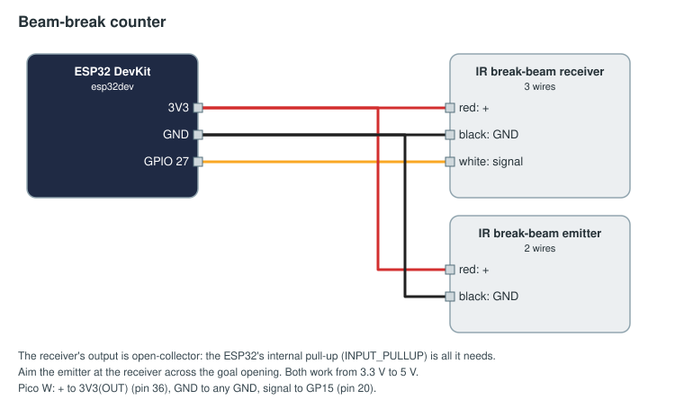

# Add your first sensor

From an ESP32 and a beam-break sensor to the audience display counting balls, in about five minutes once the parts
are on the table. You will wire the sensor, flash the board, approve it in the FMS, bind it to the score and watch
it count in a test match.

The protocol behind it is in [devices.md](devices.md); the library is in [sdk/arduino](../sdk/arduino/), and this
is the [beam-break-counter](../examples/beam-break-counter/) example.

## What you need

- An ESP32 DevKit board (the common "ESP32-WROOM-32 DevKit", PlatformIO board `esp32dev`) and a USB cable.
- An IR break-beam sensor pair, such as Adafruit 2167: an emitter (2 wires) and a receiver (3 wires).
- A computer with Python, to run PlatformIO: `pip install platformio`.
- Galaxia FMS running with the `ball-count` game, on a network the ESP32 can join over 2.4 GHz Wi-Fi. Note the FMS
  computer's address on that network (here `10.0.100.5`).

## 1. Wire it

| Sensor wire | ESP32 pin |
|-------------|-----------|
| Receiver red (+) and emitter red (+) | 3V3 |
| Receiver black and emitter black | GND |
| Receiver white (signal) | GPIO 27 |



Point the emitter at the receiver. Nothing else is needed: the board's internal pull-up reads the receiver.

## 2. Set three things in the sketch

Open [examples/beam-break-counter/arduino/beam_break_counter/beam_break_counter.ino](../examples/beam-break-counter/arduino/beam_break_counter/beam_break_counter.ino):

```cpp
GalaxiaDevice dev("beam-red-1", "Red goal beam break");
Counter balls = dev.counterPin("count", 27, INPUT_PULLUP, FALLING);

void setup() {
  dev.wifi("field-devices", "wifi-password");   // 1. your Wi-Fi name and password
  dev.connect("10.0.100.5", "device-token");    // 2. the FMS address  3. a token
}

void loop() {
  dev.loop();
}
```

The token is this device's password. Make up a long random one (a password generator is fine): the FMS accepts an
unknown device as pending and keeps the token it presented when you approve it. (Or create the device on
Setup → Devices first, and copy the token and snippet it shows.)

## 3. Flash it

With the board on USB, in a terminal:

```sh
cd examples/beam-break-counter
pio run -t upload
pio device monitor
```

The first build downloads the ESP32 tools, which takes a few minutes once. Then the monitor shows:

```
galaxia: connected to the FMS as beam-red-1
galaxia: waiting for approval on the FMS Devices page
```

## 4. Approve it

In the FMS, open **Setup → Devices**. `beam-red-1` ("Red goal beam break") is listed as pending, with its `count`
channel. Approve it. The FMS drops the device's connection so that it can reconnect with its new rights; the board
does that by itself within a second or two, and the monitor shows it connect again, this time without "waiting".

## 5. Bind it to the score

Open **Setup → Bindings** and add an input binding: device `beam-red-1`, channel `count`, action "score `balls`,
increment, alliance red", in the autonomous and teleop phases. As YAML (the Bindings page imports and exports it):

```yaml
inputs:
  - id: red-goal
    device: beam-red-1
    channel: count
    action: { score: balls, op: increment, alliance: red }
    phases: [auto, teleop]
```

## 6. Watch it count

Start a test match on Match Play and open the audience display. Pass a ball (or a hand) through the beam: red's
score goes up by 2 in autonomous and by 1 in teleop, as the `ball-count` game says.

The board sends a running total, and the FMS adds the difference, so a dropped message or a Wi-Fi blip loses no
ball. When the board restarts, it says so by sending a total of 0, and counting carries on from there.

## If it does not work

| You see | Check |
|---------|-------|
| The monitor keeps saying "cannot reach the FMS" | The FMS address, that the FMS is running, and that its MQTT port (1883) is open on that computer's firewall. |
| No "connected" line at all | The Wi-Fi name and password; the ESP32 only joins 2.4 GHz networks. |
| "the FMS refused … wrong token" | The device was approved with another token: put that token back, or give it a new one on Setup → Devices. The board retries every 30 s, so it recovers once the token matches. |
| "the FMS refused … blocked" | Someone blocked it on Setup → Devices. Unblock it there. |
| Connected, but the score does not move | Is the device approved? Is the binding saved for the game and field profile in use? Is a match running, in `auto` or `teleop`? The Devices page shows the `count` input and any refusal. |
| The count jumps by more than one per ball | Make sure the sensor's signal is clean (keep the wire short, or twist it with its ground). |

## Next

- The other [examples](../examples/): a start button, a stack light, an LED strip, an E-stop box, a match timer,
  a scale and an RFID reader.
- A Raspberry Pi Pico W instead of an ESP32: [sdk/micropython](../sdk/micropython/), with the same example in
  `examples/beam-break-counter/micropython/main.py`.
- A vision program instead of a sensor: [sdk/python](../sdk/python/), where `balls.increment(conf=0.93)` sends a
  detection with its confidence.
