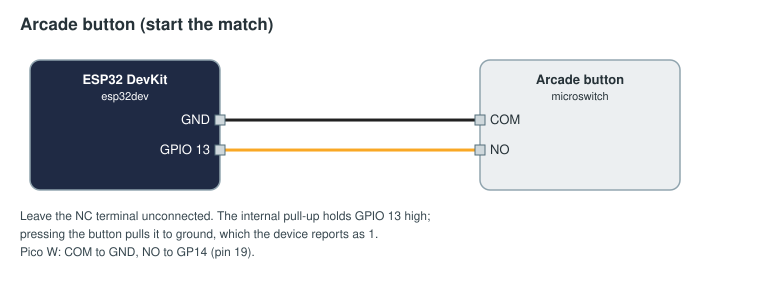

# Arcade button: start the match

A big button at the scorer's table that starts the match. The FMS still checks every start condition (stations
ready, no faults) before it starts anything, exactly as for the Start Match button.

## Parts

| Part | Notes |
|------|-------|
| ESP32 DevKit, or a Raspberry Pi Pico W / Pico 2 W | |
| Arcade push button with a microswitch (30 mm or 60 mm) | Its built-in lamp, if any, is not used here |
| Two wires with crimp connectors for the microswitch | |

## Wiring



| Microswitch terminal | ESP32 | Pico W |
|----------------------|-------|--------|
| COM | GND | GND, pin 18 |
| NO | GPIO 13 | GP14, pin 19 |
| NC | not connected | not connected |

The internal pull-up holds the pin high; pressing the button pulls it to ground. The SDK debounces for 20 ms and
reports 1 while the button is pressed.

## Flash

Change the Wi-Fi, FMS address and token in [arduino/arcade_button/arcade_button.ino](arduino/arcade_button/arcade_button.ino)
(see [the examples README](../README.md#before-you-flash)), then `pio run -t upload` in this folder.
MicroPython: copy [micropython/main.py](micropython/main.py) to the Pico as `main.py`.

## Approve and bind

Approve `arcade-1` on Setup → Devices, then on Setup → Bindings:

```yaml
inputs:
  - id: start-button
    device: arcade-1
    channel: button
    edge: rising
    min_interval_ms: 2000
    action: { field: start_match }
```

`edge: rising` acts on the press; `min_interval_ms` ignores a second press within two seconds. The same button
can do other field actions instead: `abort_match`, `field_reset`, `volunteers`, `commit` or `next_match`.
