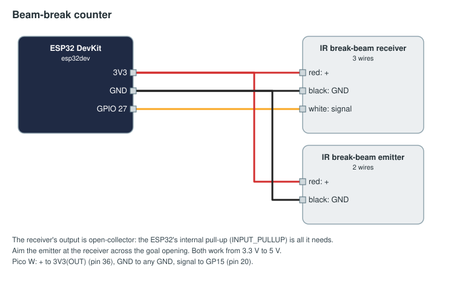

# Beam-break ball counter

An infrared beam across a goal opening. Every ball that breaks it adds to the alliance's score. The board counts
the breaks in an interrupt and sends a running total, so a lost message or a Wi-Fi hiccup loses no ball.

## Parts

| Part | Notes |
|------|-------|
| ESP32 DevKit (esp32dev), or a Raspberry Pi Pico W / Pico 2 W | |
| IR break-beam sensor pair, 3 mm or 5 mm (for example Adafruit 2167 / 2168) | Open-collector receiver; 3.3 to 5 V |
| Wire, a USB power bank or 5 V supply | |

## Wiring



| Sensor wire | ESP32 | Pico W |
|-------------|-------|--------|
| Receiver red (+) | 3V3 | 3V3(OUT), pin 36 |
| Receiver black (GND) | GND | GND, pin 38 |
| Receiver white (signal) | GPIO 27 | GP15, pin 20 |
| Emitter red (+) | 3V3 | 3V3(OUT) |
| Emitter black (GND) | GND | GND |

The receiver's output pulls the pin to ground while the beam is broken; the board's internal pull-up does the rest.

## Flash

Change the Wi-Fi, FMS address and token in [arduino/beam_break_counter/beam_break_counter.ino](arduino/beam_break_counter/beam_break_counter.ino)
(see [the examples README](../README.md#before-you-flash)), then in this folder:

```sh
pio run -t upload
pio device monitor
```

MicroPython: copy [micropython/main.py](micropython/main.py) to the Pico as `main.py`.

## Approve and bind

On Setup → Devices, approve `beam-red-1`. On Setup → Bindings, for the `ball-count` game:

```yaml
inputs:
  - id: red-goal
    device: beam-red-1
    channel: count
    action: { score: balls, op: increment, alliance: red }
    phases: [auto, teleop]
```

The FMS adds the difference between successive totals, so `increment` counts every ball even if a message is lost.
The device sends its total (0 after a restart) right after connecting; the FMS takes that as its starting point.

## Check it

Wave a hand through the beam with the serial monitor open: the device logs its connection, and the Devices page
shows the `count` input climbing. In a test match the alliance's score goes up by one ball per break.
