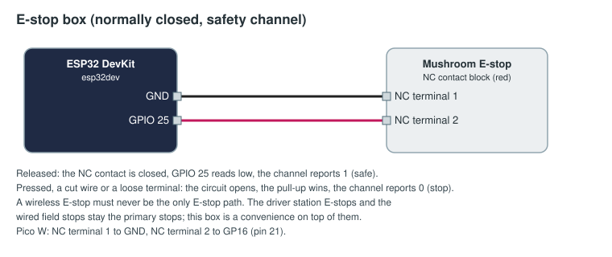

# Wireless E-stop box

A mushroom E-stop button in a box, for one driver station, that stops that station's robot through the FMS.

> **Warning.** A wireless E-stop must never be the only E-stop path. The driver station's own E-stop and the
> wired field stops remain the primary stops; this box is a convenience on top of them. It is not a
> safety-rated device, and nothing about Wi-Fi, a microcontroller or this code makes it one.

How it fails safe, as far as it can:

- The button's **normally-closed** contact is wired from the pin to ground. Released, the circuit is closed and
  the channel reads 1 (safe). Pressed, **or a wire cut, or a terminal loose**, the circuit opens and it reads 0
  (stop).
- The board sends a heartbeat every 200 ms with the button's state, and sends a press at once.
- The FMS stops the robot and latches a fault if the box reports a stop, **falls silent for one second**,
  disconnects, or is unplugged. The fault stays until an operator clears it, and only clears once the box is back
  and reports safe. A match cannot start while the box is offline or faulted.

## Parts

| Part | Notes |
|------|-------|
| ESP32 DevKit, or a Raspberry Pi Pico W / Pico 2 W | |
| 40 mm mushroom E-stop, twist or pull to release, with an **NC** contact block (usually red) | |
| Enclosure, cable gland, USB power bank or 5 V supply | Mount the button on top, easy to hit |

## Wiring



| E-stop NC contact | ESP32 | Pico W |
|-------------------|-------|--------|
| Terminal 1 | GND | GND, pin 23 |
| Terminal 2 | GPIO 25 | GP16, pin 21 |

Do not use the NO block: a cut wire would then read as "safe".

## Flash

Change the Wi-Fi, FMS address and token in [arduino/estop_box/estop_box.ino](arduino/estop_box/estop_box.ino)
(see [the examples README](../README.md#before-you-flash)), then `pio run -t upload` in this folder.
MicroPython: copy [micropython/main.py](micropython/main.py) to the Pico as `main.py`.

## Approve and bind

Approve `estop-box-red` on Setup → Devices, then on Setup → Bindings:

```yaml
inputs:
  - id: estop-red-1
    device: estop-box-red
    channel: stop
    action: { field: estop, station: R1 }
```

Use `astop` for an autonomous stop, or `field_stop` for a box that stops every robot and aborts the match.

## Check it before every event

1. With the box connected and released, the Devices page shows `stop` at 1 and a steady heartbeat.
2. Press it during a test match: station R1 E-stops at once.
3. Pull a wire, then switch the box off: each time the FMS stops the station and latches a fault.
4. Release, reconnect, and clear the fault on the Devices page or Match Play.
