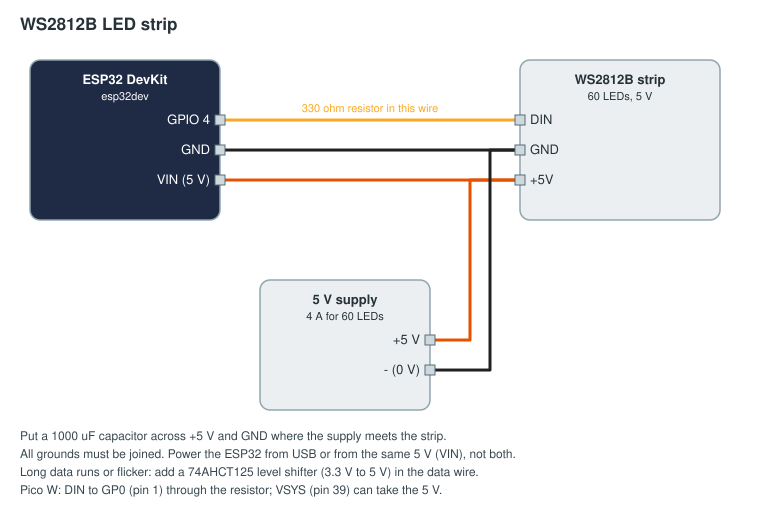

# WS2812B LED strip

An addressable strip on a goal, a driver station or the field border. The FMS sends looks (solid, blink, pulse,
chase, rainbow, progress, segments, brightness), and the library draws them on the board from the field clock,
exactly as the Lighting page's preview draws them, so strips on different boards blink and chase in step.

## Parts

| Part | Notes |
|------|-------|
| ESP32 DevKit, or a Raspberry Pi Pico W / Pico 2 W | |
| WS2812B strip, 60 LEDs, 5 V | Other lengths: change `60` in the sketch |
| 5 V supply, 4 A for 60 LEDs at full white (less with `limit`) | |
| 330 Ω resistor in the data wire, 1000 µF capacitor across the supply | |
| Optional: 74AHCT125 level shifter for long data runs | |

## Wiring



| From | To | ESP32 | Pico W |
|------|----|-------|--------|
| Strip DIN | through 330 Ω | GPIO 4 | GP0, pin 1 |
| Strip GND | ground | GND | GND, pin 3 |
| Strip +5V | 5 V supply + | VIN (if the board is powered from the same supply) | VSYS, pin 39 |
| 5 V supply − | every ground | GND | GND |

All grounds must be joined. Power the board from USB or from the 5 V supply, not both.

## Flash

Change the Wi-Fi, FMS address and token in [arduino/led_strip/led_strip.ino](arduino/led_strip/led_strip.ino)
(see [the examples README](../README.md#before-you-flash)), then `pio run -t upload` in this folder.
MicroPython: copy [micropython/main.py](micropython/main.py) to the Pico as `main.py`.

`strip.limit(0.5)` (MicroPython: `limit=0.5`) caps the brightness at half, on top of whatever the FMS asks for,
to keep 60 LEDs under 2 A. Remove it with a big enough supply.

## Approve and set up

Approve `goal-red` on Setup → Devices. Then the easy way: on Setup → Lighting, add the strip as a fixture (with
named segments if parts of it mean different things) and give it a look for each moment. A new fixture starts
with a sensible set: alliance colour during the match, green on field reset, red blinking on E-stop.

Or bind it directly on Setup → Bindings:

```yaml
outputs:
  - id: goal-strip
    device: goal-red
    channel: strip
    alliance: red
    when: "match_state == 'running'"
    look: { p: chase, c: ["alliance"], ms: 1000 }
    else: { p: solid, c: ["#101010"] }
```

A progress bar of the time left in the phase:

```yaml
outputs:
  - id: time-bar
    device: goal-red
    channel: strip
    look: { p: progress, c: ["#00c853", "#202020"], v: "phase_remaining / phase_duration" }
```

Identify on the Devices page flashes the whole strip white for five seconds.
