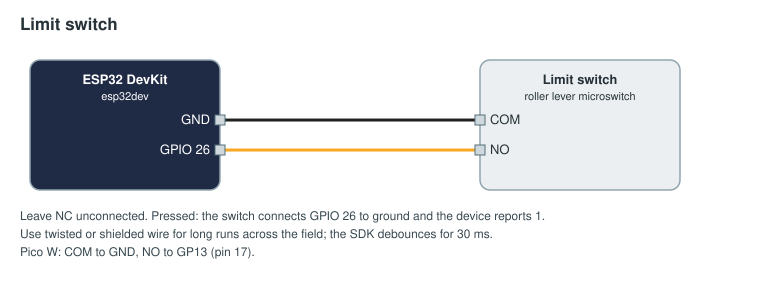

# Limit switch: a platform held down

A roller-lever limit switch under a scoring platform. While a robot holds the platform down the switch is closed
and a timer element of the game runs; it stops when the robot leaves. The same wiring works for any "is something
there" switch: a gate, a door, a lever.

## Parts

| Part | Notes |
|------|-------|
| ESP32 DevKit, or a Raspberry Pi Pico W / Pico 2 W | |
| Roller-lever microswitch (for example a V-156-1C25 or any 3-terminal lever switch) | |
| Two-core cable, twisted or shielded for long runs | |

## Wiring



| Switch terminal | ESP32 | Pico W |
|-----------------|-------|--------|
| COM | GND | GND, pin 18 |
| NO | GPIO 26 | GP13, pin 17 |
| NC | not connected | not connected |

Pressed reads 1. A change must hold for 30 ms before it is sent, which rides out contact bounce and a robot
rocking on the plate.

## Flash

Change the Wi-Fi, FMS address and token in [arduino/limit_switch/limit_switch.ino](arduino/limit_switch/limit_switch.ino)
(see [the examples README](../README.md#before-you-flash)), then `pio run -t upload` in this folder.
MicroPython: copy [micropython/main.py](micropython/main.py) to the Pico as `main.py`.

## Approve and bind

Approve `platform-red` on Setup → Devices. With the `orbital-rush` game, whose `station_hold` timer may be edited
by devices:

```yaml
inputs:
  - id: red-station-hold
    device: platform-red
    channel: plate
    action: { score: station_hold, op: hold, alliance: red }
```

`hold` starts the timer on 1 and stops it on 0. To set a boolean instead (the `beacon` element, say), use
`action: { score: beacon, op: set, value: true, alliance: red }` with `edge: rising`, and add `debounce_ms: 50`
if the FMS should wait longer than the device does.
