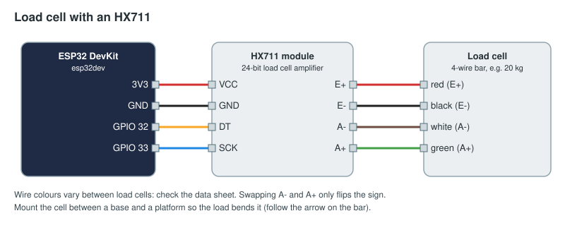

# Load cell: weigh a payload

A platform on a load cell, read through an HX711 amplifier. The device sends raw readings; the binding turns them
into kilograms, so you calibrate in the FMS without touching the firmware.

## Parts

| Part | Notes |
|------|-------|
| ESP32 DevKit | |
| HX711 load cell amplifier module | |
| Bar load cell, 4 wires (for example 20 kg or 50 kg), with a base and a platform | |
| A known weight for calibration (a 5 kg plate, say) | |

## Wiring



| From | To |
|------|----|
| HX711 VCC | ESP32 3V3 |
| HX711 GND | ESP32 GND |
| HX711 DT | GPIO 32 |
| HX711 SCK | GPIO 33 |
| Load cell red, black, white, green | HX711 E+, E−, A−, A+ |

Load cell colours vary: check the data sheet. If the readings fall as weight goes on, swap A− and A+ (or use a
negative scale in the binding).

## Flash

Change the Wi-Fi, FMS address and token in [arduino/load_cell/load_cell.ino](arduino/load_cell/load_cell.ino)
(see [the examples README](../README.md#before-you-flash)), then `pio run -t upload` in this folder. The
`platformio.ini` adds the HX711 library (bogde) 0.7.5.

The sketch smooths the readings a little, skips changes smaller than 50 counts, and sends at most five readings a
second.

## Calibrate and bind

1. Approve `load-cell` on Setup → Devices and watch its `weight` input.
2. With the platform empty, note the reading: `r0`.
3. Put the known mass `m` (kg) on it and note the reading: `r1`.
4. `scale = m / (r1 − r0)` and `offset = −r0 × scale`.

Then, for the `orbital-rush` game's `payload_mass` element (a number in kg that devices may set):

```yaml
inputs:
  - id: blue-payload
    device: load-cell
    channel: weight
    scale: 0.0000412      # kg per count, from step 4
    offset: -3.07         # kg, from step 4
    action: { score: payload_mass, op: set, alliance: blue }
```

The FMS applies a new value only when it differs from the last one it applied. To use the scale as a switch
("more than 10 kg on the platform") add `threshold: 10` (and `hysteresis: 0.5`) and use a digital action.
