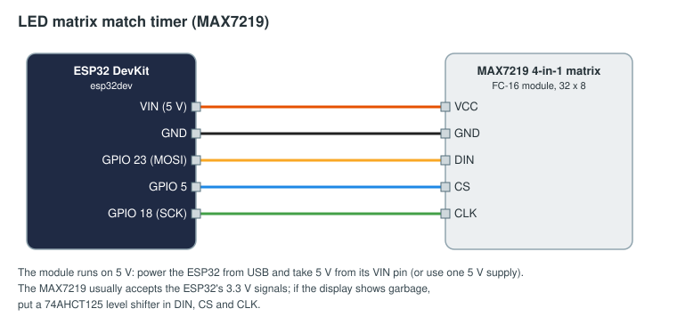

# LED matrix match timer

A 32 × 8 LED matrix showing the time left in the current phase (`2:15`, `0:07`), for the drivers or the pits. It
reads `field/state`, which every device receives, so it needs no binding.

## Parts

| Part | Notes |
|------|-------|
| ESP32 DevKit | |
| MAX7219 4-in-1 dot-matrix module, "FC-16" type (four 8 × 8 blocks, 32 × 8) | Two modules chained make a bigger display: change `4` to `8` |
| 5 V supply or USB | The matrix draws up to about 300 mA at brightness 4 |

A MAX7219 module is the simplest choice: one chip per block, one SPI bus, one library (MD_Parola). A HUB75 panel
is brighter and bigger but needs 13 data pins and a dedicated driver library.

## Wiring

| Matrix pin | ESP32 |
|------------|-------|
| VCC | VIN (5 V from USB) |
| GND | GND |
| DIN | GPIO 23 (MOSI) |
| CS | GPIO 5 |
| CLK | GPIO 18 (SCK) |

## Flash

Change the Wi-Fi, FMS address and token in [arduino/match_timer/match_timer.ino](arduino/match_timer/match_timer.ino)
(see [the examples README](../README.md#before-you-flash)), then `pio run -t upload` in this folder. The
`platformio.ini` adds MD_Parola 3.7.5 and MD_MAX72XX 3.5.1.

## In the FMS

No binding is needed. A device that only reads the field may even stay pending, since pending devices receive
`field/#` too; approve it anyway to see it on the Devices page as yours.

The display shows `--:--` until the first `field/state` arrives, then the phase's time left, rounded up to whole
seconds (FRC style) and counted down smoothly between the FMS's once-a-second updates while the match runs.
`dev.field().score("red")` and `dev.field().phase` are there for a version that shows more.
