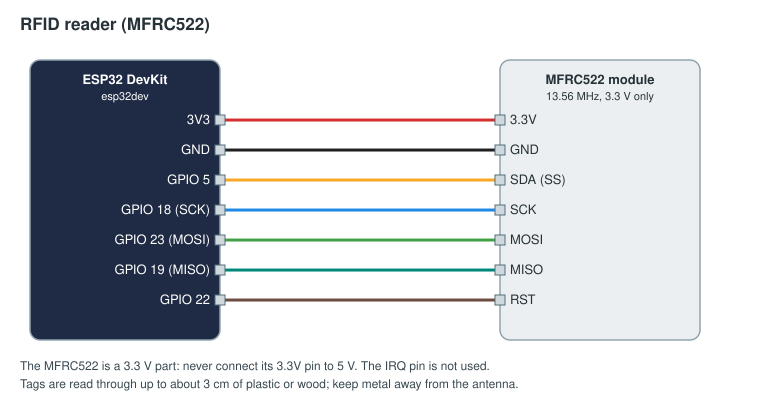

# RFID reader: set an enum from a tag

An MFRC522 reader that sends a text for each tag held to it. The FMS sets an enum element to that text, which must
be one of the element's option ids, so the sketch keeps a small table from tag UIDs to option ids. For example: a
tag on each game piece type, read where pieces are scored; or a tag on each robot, read at a docking bay.

## Parts

| Part | Notes |
|------|-------|
| ESP32 DevKit | |
| MFRC522 13.56 MHz reader module (the common blue "RC522" board) | 3.3 V only |
| MIFARE Classic or NTAG cards, key fobs or stickers | |

## Wiring



| MFRC522 pin | ESP32 |
|-------------|-------|
| 3.3V | 3V3 (never 5 V) |
| GND | GND |
| SDA (SS) | GPIO 5 |
| SCK | GPIO 18 |
| MOSI | GPIO 23 |
| MISO | GPIO 19 |
| RST | GPIO 22 |
| IRQ | not connected |

## Flash

Change the Wi-Fi, FMS address and token in [arduino/rfid_reader/rfid_reader.ino](arduino/rfid_reader/rfid_reader.ino)
(see [the examples README](../README.md#before-you-flash)), then `pio run -t upload` in this folder. The
`platformio.ini` adds the MFRC522 library (miguelbalboa) 1.4.12.

Each tap sends one message; the tag has to leave the reader before it counts again.

## Find your tags' UIDs

Tap each tag with the serial monitor open (`pio device monitor`): the sketch prints `tag 04a1b2c3 -> 04a1b2c3`.
An unknown tag is sent as its UID, which the FMS refuses for an enum (the refusal, with the text, shows on the
Devices page). Put each UID in the `known` table with the option id it stands for, and flash again.

## Approve and bind

Approve `rfid-red` on Setup → Devices. The element must be an enum that devices may edit (its `edit` list
includes `device`). With the `orbital-rush` game's robot-scope `dock` enum (options `none`, `low`, `high`), after
adding `device` to its `edit` list:

```yaml
inputs:
  - id: red-dock-reader
    device: rfid-red
    channel: tag
    action: { score: dock, op: set, alliance: red, robot: 1 }
```
