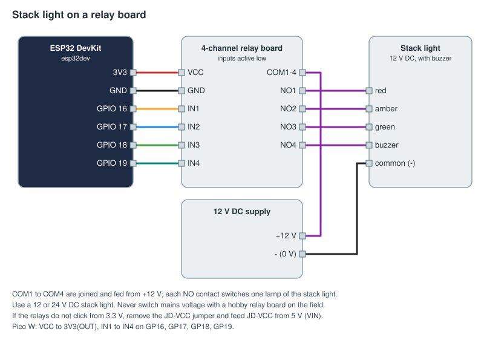

# Stack light

A red, amber and green tower light with a buzzer, switched by a 4-channel relay board. The device only switches
what it is told; what each lamp means is set in the FMS, on Setup → Lighting or with output bindings.

## Parts

| Part | Notes |
|------|-------|
| ESP32 DevKit, or a Raspberry Pi Pico W / Pico 2 W | |
| 4-channel 5 V relay board with optocouplers (inputs active low) | The common blue SRD-05VDC boards |
| 12 V or 24 V DC LED stack light with buzzer (red, amber, green) | Low voltage only |
| 12 V (or 24 V) DC supply to suit the stack light | |

**Use a low-voltage DC stack light. Never switch mains voltage with a hobby relay board on the field.**

## Wiring



| From | To | ESP32 pin | Pico W pin |
|------|----|-----------|------------|
| Relay board VCC | 3.3 V | 3V3 | 3V3(OUT), pin 36 |
| Relay board GND | ground | GND | GND |
| IN1 (red) | | GPIO 16 | GP16, pin 21 |
| IN2 (amber) | | GPIO 17 | GP17, pin 22 |
| IN3 (green) | | GPIO 18 | GP18, pin 24 |
| IN4 (buzzer) | | GPIO 19 | GP19, pin 25 |
| COM1 to COM4 (joined) | 12 V supply + | | |
| NO1, NO2, NO3, NO4 | stack light red, amber, green, buzzer | | |
| Stack light common | 12 V supply − | | |

If the relays do not click from 3.3 V, remove the JD-VCC jumper and feed JD-VCC from 5 V (VIN on the ESP32, VBUS
on the Pico), keeping VCC on 3.3 V.

## Flash

Change the Wi-Fi, FMS address and token in [arduino/stack_light/stack_light.ino](arduino/stack_light/stack_light.ino)
(see [the examples README](../README.md#before-you-flash)), then `pio run -t upload` in this folder.
MicroPython: copy [micropython/main.py](micropython/main.py) to the Pico as `main.py`.

## Approve and set up

Approve `stack-light` on Setup → Devices. The simplest way to drive it is Setup → Lighting: add the four relay
outputs as fixtures and pick a look for each moment (E-stop, fault, field reset, each phase…). Or bind them
directly on Setup → Bindings:

```yaml
outputs:
  - id: stack-green
    device: stack-light
    channel: green
    when: "match_state == 'running'"
  - id: stack-amber
    device: stack-light
    channel: amber
    when: "field_reset"
  - id: stack-red
    device: stack-light
    channel: red
    when: "fault"
    look: { p: blink, ms: 500 }
  - id: stack-buzzer
    device: stack-light
    channel: buzzer
    on: match.end
    pulse_ms: 1500
```

A channel can be driven by one binding or by the Lighting page, not both. The FMS blinks a relay itself when its
look says `blink`; the device just follows each `{"v":1}` and `{"v":0}`.
